# LiftSafe · Semana 05 — API con PostgreSQL y Prisma ORM

API REST en **Node.js + Express + TypeScript** que guarda los ascensores en **PostgreSQL** con **Prisma ORM**: migraciones versionadas, seed idempotente, validación con Zod y errores de base de datos traducidos a `AppError`.

## Dominio

**LiftSafe** gestiona la inspección técnica de ascensores (NTC 5926-1). Cada **ascensor** (recurso principal) está instalado en un **edificio** (recurso secundario). Un edificio tiene muchos ascensores: relación **1:N**.

| Recurso | Modelo Prisma | Tabla | Ruta |
|---|---|---|---|
| Principal | `Elevator` (ascensor) | `elevators` | `/api/v1/elevators` |
| Secundario | `Building` (edificio) | `buildings` | (incluido en el detalle del ascensor) |

## Diagrama de entidades

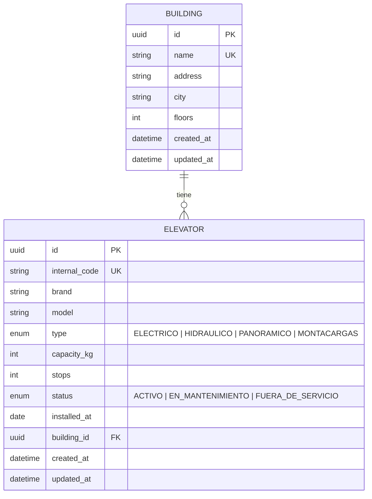

En texto:

```
buildings (1) ───────< (N) elevators
  id  UUID PK               id            UUID PK
  name  único               internal_code único (ASC-001)
  address, city, floors     brand, model, type, capacity_kg, stops,
                            status, installed_at
                            building_id   UUID FK → buildings.id (ON DELETE RESTRICT)
```

- Toda llave primaria es `String @id @default(uuid()) @db.Uuid` y la llave foránea `buildingId` es `String @db.Uuid` (regla del bootcamp).
- `onDelete: Restrict`: no se puede borrar un edificio que todavía tiene ascensores.

## Cómo ejecutar

Requisitos: Node.js 20+, pnpm y Docker.

```bash
cd api-semana05
docker compose up -d                      # 1. PostgreSQL 16 en el puerto 5432
pnpm install                              # 2. dependencias (también genera el cliente de Prisma)
cp .env.example .env                      # 3. variables de entorno
pnpm prisma migrate dev                   # 4. aplica la migración versionada (prisma/migrations)
pnpm prisma db seed                       # 5. datos demo: 4 edificios y 8 ascensores
pnpm dev                                  # 6. http://localhost:3000/api/v1/elevators
pnpm test                                 # pruebas (las de integración usan la base del .env)
```

Se usa `pnpm prisma …` (el Prisma 6.19.3 instalado en el proyecto) en vez de `pnpm dlx prisma …`: `dlx` descarga la versión más reciente de Prisma, que ya es otra versión mayor y no lee este schema igual. También existen los atajos `pnpm db:migrate` y `pnpm db:seed`.

La migración inicial ya está en `prisma/migrations/20261110200000_init/`, así que el paso 4 no crea otra: solo la aplica.

## Seed

`prisma/seed.ts` carga 4 edificios y 8 ascensores. Es **idempotente**: usa `upsert` por los campos únicos (`name` del edificio e `internalCode` del ascensor), así que se puede correr varias veces sin duplicar nada.

Logs de `pnpm prisma db seed`, corrido dos veces seguidas (la segunda no duplica):

```text
$ pnpm prisma db seed
Running seed command `tsx prisma/seed.ts` ...
🌱 Seed de LiftSafe (semana 5)
   🏢 Edificios: 4 listos
   🛗 Ascensores: 8 listos
✅ En la base: 4 edificios y 8 ascensores
🌱  The seed command has been executed.

$ pnpm prisma db seed
Running seed command `tsx prisma/seed.ts` ...
🌱 Seed de LiftSafe (semana 5)
   🏢 Edificios: 4 listos
   🛗 Ascensores: 8 listos
✅ En la base: 4 edificios y 8 ascensores
🌱  The seed command has been executed.
```

## Endpoints

| Método | Ruta | Descripción | Respuestas |
|---|---|---|---|
| GET | `/api/v1/elevators?page=1&limit=10` | Listado paginado | 200, 400 |
| GET | `/api/v1/elevators/:id` | Detalle con su edificio | 200, 400, 404 |
| POST | `/api/v1/elevators` | Crear (valida con Zod) | 201, 400, 409 |
| PUT | `/api/v1/elevators/:id` | Actualizar (campos opcionales) | 200, 400, 404, 409 |
| DELETE | `/api/v1/elevators/:id` | Eliminar | 204, 400, 404 |

### GET `/api/v1/elevators?page=1&limit=3` → 200

```json
{
  "data": [
    { "id": "7e85955e-5d4d-478d-adcb-3dd5476ea8ae", "internalCode": "ASC-001", "brand": "Otis", "model": "Gen2",
      "type": "ELECTRICO", "capacityKg": 630, "stops": 18, "status": "ACTIVO",
      "installedAt": "2019-03-15T00:00:00.000Z", "buildingId": "4b2b1e09-c90a-4539-8c95-4dc23e5f6c22", "...": "..." }
  ],
  "total": 8,
  "page": 1,
  "limit": 3
}
```

### GET `/api/v1/elevators/:id` → 200 (incluye la relación)

```json
{
  "data": {
    "id": "7e85955e-5d4d-478d-adcb-3dd5476ea8ae", "internalCode": "ASC-001", "...": "...",
    "building": { "id": "4b2b1e09-c90a-4539-8c95-4dc23e5f6c22", "name": "Torre Central", "address": "Cra. 7 # 32-16", "city": "Bogotá", "floors": 18 }
  }
}
```

### POST `/api/v1/elevators` → 201

```json
{
  "internalCode": "ASC-010", "brand": "Kone", "model": "MonoSpace 700", "type": "ELECTRICO",
  "capacityKg": 900, "stops": 18, "installedAt": "2025-02-10",
  "buildingId": "4b2b1e09-c90a-4539-8c95-4dc23e5f6c22"
}
```

Responde `{ "data": { "id": "d40455f6-…", "internalCode": "ASC-010", …, "building": { … } } }`.

### PUT `/api/v1/elevators/:id` → 200

```json
{ "status": "EN_MANTENIMIENTO", "capacityKg": 1000 }
```

### DELETE `/api/v1/elevators/:id` → 204 (sin cuerpo)

### Errores

| Caso | Código | Cuerpo |
|---|---|---|
| Body inválido (Zod) | 400 | `{ "status": "error", "message": "Datos inválidos", "issues": [...] }` |
| `:id` que no es UUID | 400 | `{ "status": "error", "message": "Datos inválidos", "issues": [...] }` |
| `buildingId` que no existe (Prisma **P2003**) | 400 | `{ "status": "error", "message": "El edificio indicado no existe" }` |
| Registro que no existe (Prisma **P2025**, o detalle vacío) | 404 | `{ "status": "error", "message": "Recurso no encontrado" }` |
| Código interno repetido (Prisma **P2002**) | 409 | `{ "status": "error", "message": "Ya existe un registro con ese valor" }` |
| Ruta inexistente | 404 | `{ "status": "error", "message": "Ruta no encontrada: ..." }` |
| Cualquier otro error | 500 | `{ "status": "error", "message": "Error interno del servidor" }` |

## Decisiones de diseño

- **Capas**: rutas → controlador (Zod + `next(err)`) → servicio (lógica) → repositorio (único que usa Prisma).
- **Errores de Prisma**: `src/errors/prismaErrors.ts` traduce P2025 → `AppError(404)`, P2002 → `AppError(409)` y P2003 → `AppError(400)`. El repositorio lo usa en cada escritura y el `errorHandler` también, por si algún error llega sin traducir. Todos los errores pasan por el `errorHandler`.
- **Prisma Client singleton** en `src/lib/prisma.ts` (no se abren conexiones nuevas con cada recarga de `tsx watch`).
- **Cliente sin binario de Rust** (`engineType = "client"` + `@prisma/adapter-pg`): disponible de forma estable desde Prisma 6.16. Las consultas van por el driver `pg`.
- **Paginación** en el servicio con `skip`/`take` y `count` en paralelo; responde `{ data, total, page, limit }`.
- **Cierre ordenado**: con `SIGINT`/`SIGTERM` el servidor deja de recibir peticiones y cierra la conexión a la base.

## Capturas

Peticiones reales contra la API corriendo con `pnpm dev` y la base cargada con el seed.

| # | Endpoint | Captura |
|---|---|---|
| 1 | GET listado paginado → 200 | 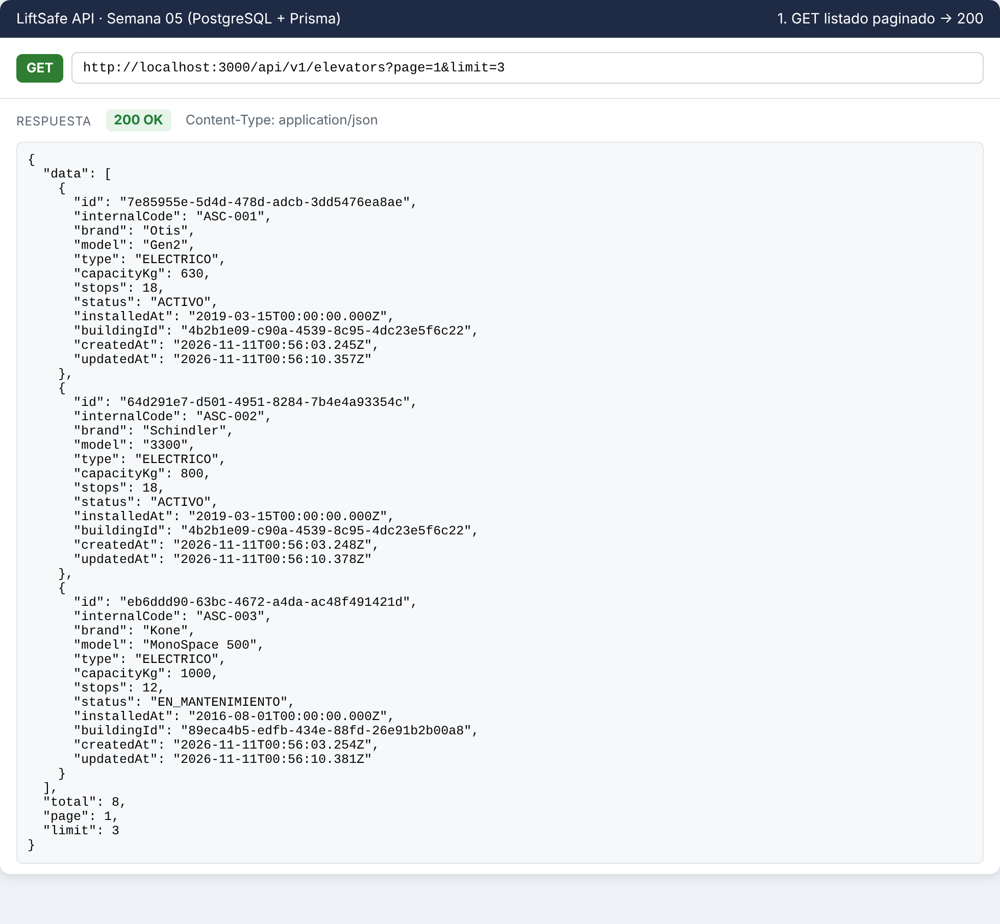 |
| 2 | GET detalle con el edificio → 200 | 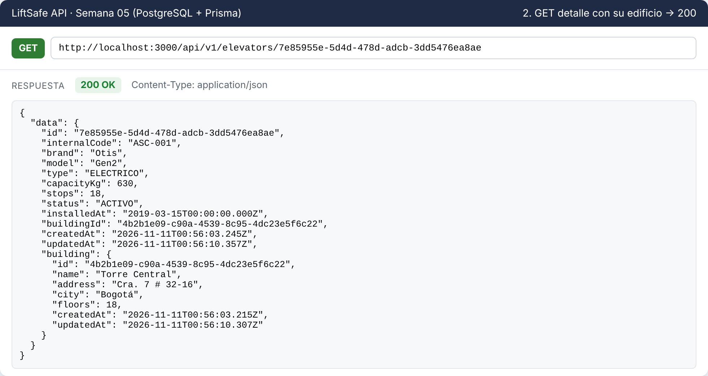 |
| 3 | POST crear → 201 | 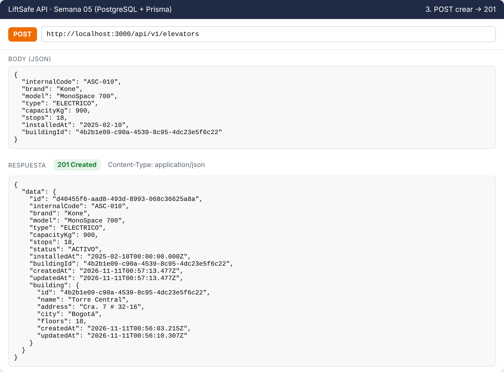 |
| 4 | PUT actualizar → 200 | 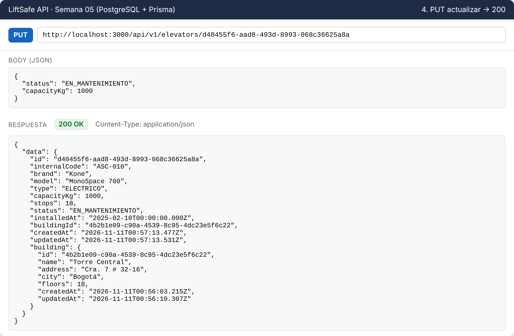 |
| 5 | DELETE eliminar → 204 | 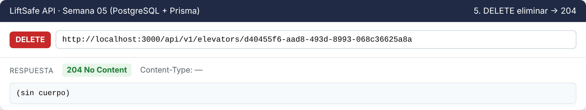 |
| 6 | POST código repetido → 409 (P2002) | 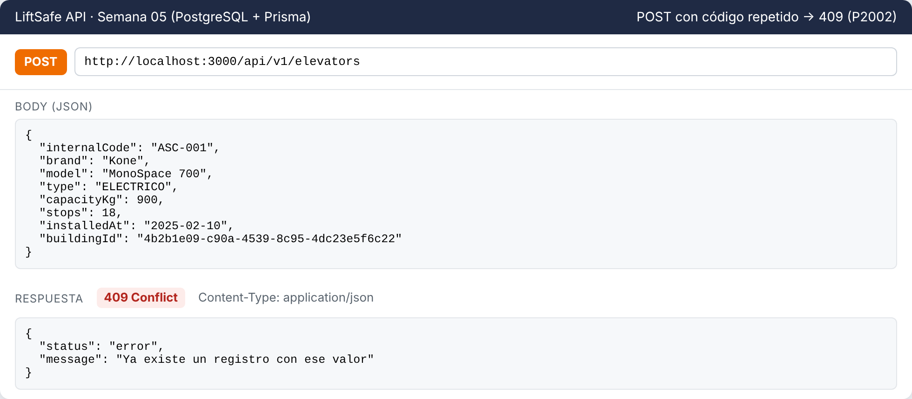 |
| 7 | GET id inexistente → 404 | 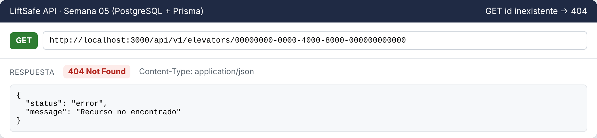 |
| 8 | DELETE de uno ya eliminado → 404 (P2025) | 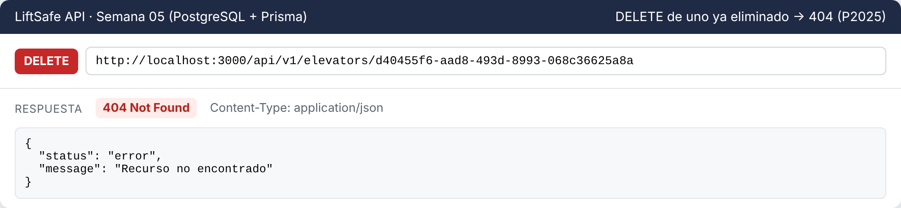 |
| 9 | Logs del servidor | 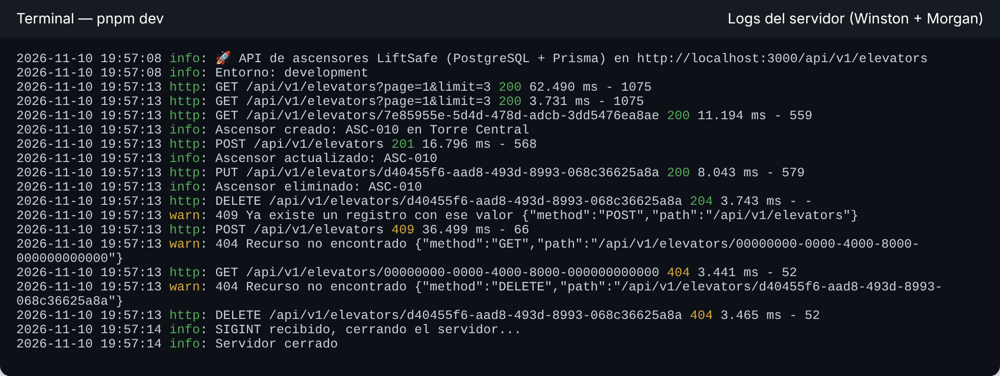 |
| 10 | Logs del seed | 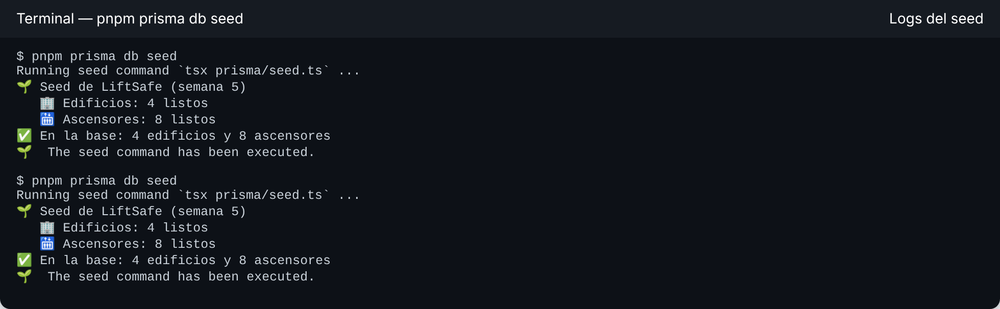 |

La colección `postman/LiftSafe-Semana05.postman_collection.json` trae las mismas peticiones para Postman o Thunder Client.
