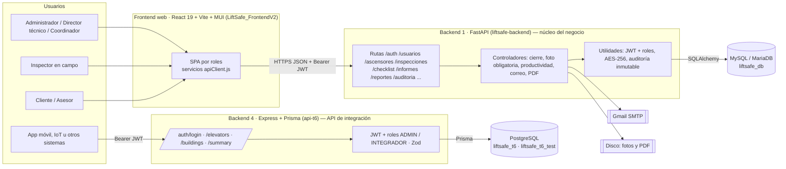
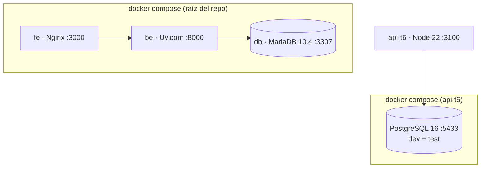

# 03 · Arquitectura del sistema (T6)

**Ítem 5 de la lista T6.** Diagrama actualizado al cierre de T6 y guion de la demo end-to-end.

## Vista general

Los **backends 2 y 3** (`api-semana04`, `api-semana05`) fueron etapas de aprendizaje de Express
(memoria y luego PostgreSQL + Prisma). El 4.° backend (`api-t6`) los evoluciona y agrega
autenticación; ver [08-reflexion-4-backends.md](08-reflexion-4-backends.md).

## Capas dentro de cada backend

| Capa | Backend 1 · FastAPI | Backend 4 · api-t6 |
|---|---|---|
| Entrada HTTP | `app/routes/*.py` | `src/routes/*.routes.ts` |
| Validación | Pydantic (`app/schemas`) | Zod (`src/schemas`) |
| Autenticación | `utils/auth_deps.py` (python-jose, HS256) | `middlewares/auth.ts` (jsonwebtoken, HS256) |
| Negocio | `app/controllers` | `src/services` |
| Datos | SQLAlchemy (`app/models`) | Prisma (`src/repositories`) |
| Errores | Manejadores en `app/main.py` (JSON + CORS) | `middlewares/errorHandler.ts` |

## Despliegue

## Guion de la demo end-to-end (≈10 min)

1. `docker compose up -d --build` en la raíz → abrir http://localhost:3000.
2. **Administrador**: inicia sesión, revisa el tablero y la lista de chequeo NTC 5926-1.
3. **Asesor**: crea un cliente y su edificio; registra un ascensor dentro del edificio.
4. **Coordinador**: programa una inspección para ese ascensor.
5. **Inspector**: ejecuta el checklist, sube fotos, firma y recoge la **firma presencial del cliente**.
6. **Coordinador**: aprueba; se genera el **PDF** del informe y se envía la encuesta.
7. **Administrador**: descarga el **Excel de productividad** y revisa la **auditoría**.
8. **4.° backend**: en Postman, `POST /auth/login` como INTEGRADOR → `GET /elevators/summary`;
   intentar `POST /elevators` con ese token → **403**; con ADMIN → **201**.
